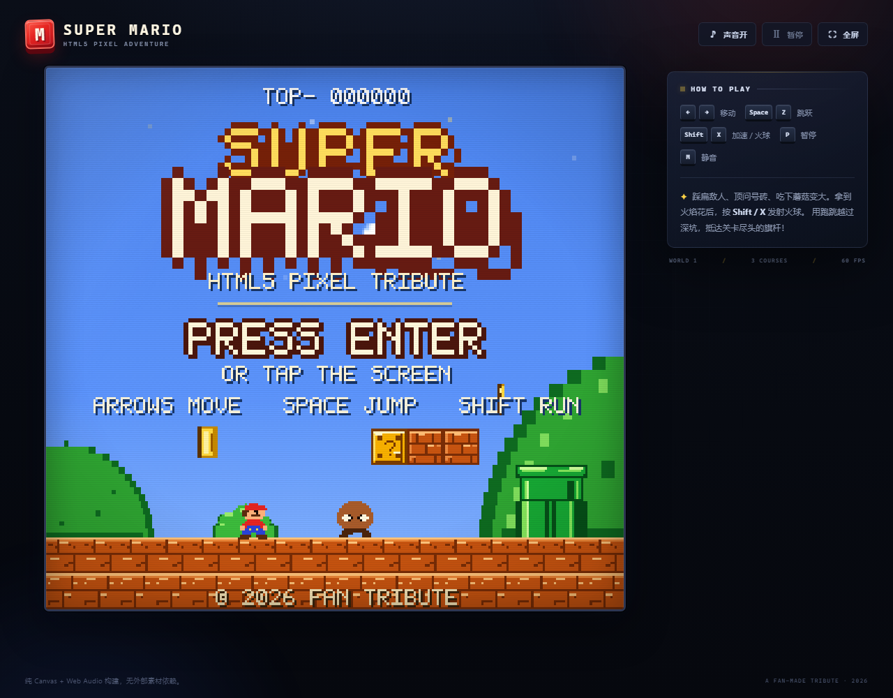
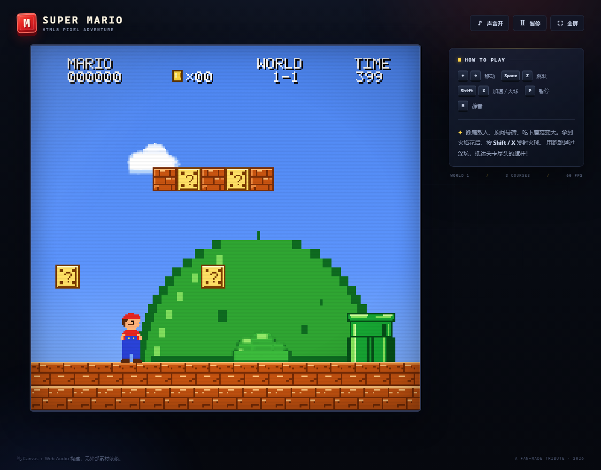

# SUPER MARIO · HTML5 PIXEL ADVENTURE

一个纯 HTML5 Canvas + Web Audio 实现的像素马力欧风格平台游戏。无需安装、无需构建、没有任何外部图片/音频依赖，双击 `index.html` 即可游玩。

## 截图





## 立即开始

1. 双击 `index.html`，或把它拖进浏览器。
2. 在标题画面按 `Enter`、`Space`、`Z`，或直接点击/触摸画面。
3. 建议使用 Chrome / Edge / Firefox 的较新版本。

也可以在本目录起一个静态服务器：

```bash
# 任选其一
python -m http.server 8080
npx serve .
```

然后打开 <http://localhost:8080>。

## 操作

| 按键 | 功能 |
| --- | --- |
| `←` / `→` 或 `A` / `D` | 左右移动 |
| `Space` / `Z` / `K` / `↑` / `W` | 跳跃（按住跳得更高） |
| `Shift` / `X` / `J` | 加速；变为火焰马力欧后发射火球 |
| `P` / `Esc` | 暂停 / 继续 |
| `M` | 静音 / 恢复声音 |
| `F` | 全屏 / 退出全屏 |
| `Enter` | 标题、通关、游戏结束后开始 |

触屏设备会自动显示虚拟方向键与 `A`（跳跃）/ `B`（加速、火球）按钮。

## 游戏内容

- **3 个完整关卡**：1-1 蘑菇平原、1-2 地下水道、1-3 星夜高台。
- 马力欧的三种形态：小马力欧、超级马力欧、火焰马力欧。
- 蘑菇、火焰花、无敌星星、1UP 蘑菇、金币。
- 顶问号砖、顶碎砖块、道具从砖块中升起、砖块顶怪。
- 板栗仔、乌龟、可踢动龟壳；龟壳能连续击败其他敌人。
- 连续踩敌计分、旗杆高度奖励、时间奖励、最高分保存。
- 旗杆终点 + 城堡动画；1-2 的出口水管；通关结尾与烟花。
- 原创 8-bit 配乐（地面 / 地下 / 星夜 / 无敌状态）和全套合成音效。
- 暂停、静音、全屏、键盘与触屏、响应式布局。

## 文件结构

```text
index.html          页面、HUD 外的 HTML 按钮和触控区
css/style.css       街机外框、响应式布局、CRT 扫描线
js/audio.js         Web Audio 合成器、循环配乐、音效
js/art.js           像素美术、字体、砖块、角色、背景、城堡
js/levels.js        三个关卡的坐标数据与敌人/金币布置
js/game.js          60 FPS 游戏循环、物理、碰撞、状态机、渲染
```

## 实现说明

- 游戏内部分辨率为经典的 **256 × 240**，用 CSS 整数友好的方式放大显示。
- 物理与逻辑以固定 60 次/秒更新；渲染跟随浏览器刷新率。
- 所有精灵与场景由 Canvas 的像素绘制代码生成，不含图片文件。
- 音乐与音效由 Web Audio API 的振荡器与噪声实时合成。
- 角色与关卡是向经典 8-bit 平台游戏致敬的原创像素实现，未使用任天堂官方素材。

## 分享给其他人 / 部署

这是一个**纯静态**项目，不需要后端、数据库或自己的服务器。

### 方案 A：GitHub Pages（推荐，免费）

1. 在 GitHub 新建一个 **Public** 仓库。
2. 把本目录的 `index.html`、`css/`、`js/`（以及可选的 `README.md`）上传到仓库**根目录**。`index.html` 必须在根目录，不能整套塞进一个外层文件夹。
3. 打开仓库的 **Settings → Pages**。
4. **Build and deployment → Source** 选 **Deploy from a branch**，Branch 选 `main`、目录选 `/(root)`，点 Save。
5. 等 1–3 分钟，访问：

   ```text
   https://你的用户名.github.io/仓库名/
   ```

   如果仓库名本身是 `你的用户名.github.io`，地址就是 `https://你的用户名.github.io/`。

命令行上传：

```bash
cd D:\AITEST
git init
git add index.html css js README.md
git commit -m "Super Mario HTML5"
git branch -M main
git remote add origin https://github.com/你的用户名/仓库名.git
git push -u origin main
```

然后在 GitHub 仓库里按上面的 Settings → Pages 开启即可。更新游戏后再次 `git push` 就会自动更新。

### 方案 B：Netlify Drop（最快，无需 Git）

打开 [Netlify Drop](https://app.netlify.com/drop)，把整个 `D:\AITEST` 文件夹拖进去，几秒后会得到一个可以直接分享的网址。之后把文件夹重新拖入即可更新。

同类免费静态托管：Cloudflare Pages、Vercel、Surge。

### 方案 C：直接发压缩包

把 `index.html`、`css/`、`js/` 一起压缩后发给对方，解压后双击 `index.html` 就能离线玩。**不要只发 `index.html`**，它需要同目录下的 `css/` 和 `js/`。

注意：浏览器要求音频必须由一次点击/按键触发，所以进入标题后点击画面或按 Enter 才会出声，这是正常现象。每位玩家的最高分和静音状态保存在他们自己的浏览器本地存储中。

## 小提示

- 跑起来再跳，可以越过更远的坑；4 格高的水管也能跳上去。
- 站在问号砖下方顶它；变大后可以顶碎砖块。
- 龟壳踢出去后会撞飞路上的敌人，但反弹回来的龟壳也会伤到自己。
- 1-2 结尾的水管上方有金色向下箭头，跳上水管即可进入下一关。
- 手机横屏视野更完整；桌面端键盘体验最佳。
